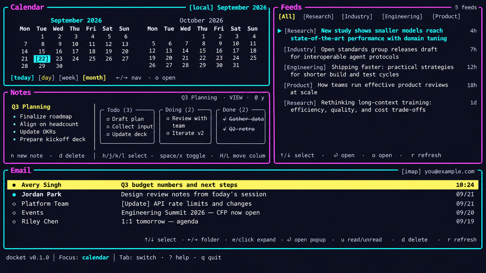

# docket

[](https://github.com/nicococo/docket/actions/workflows/ci.yml) [](https://codecov.io/gh/nicococo/docket) [](LICENSE)

**A quick-glance cockpit for the working moment.** Built for Herdr, docket gives you and your coding agents one shared view of the day: catch up on what’s new, scribble a next step before it slips, and get back to the work in front of you.



*Illustrated mockup; content and colors depend on your terminal and data.*

## Made for the moment

- **Calendar** — See today’s shape across local, CalDAV, and ICS calendars without leaving the terminal.
- **Feeds** — Scan chosen RSS and Atom sources to catch what’s new without opening a stack of sites.
- **Notes** — Write plain Markdown files in the notes folder set in Settings; they stay fully compatible with Obsidian. Headings and checklists can become a Kanban board, keeping quick scribbles and next steps together.
- **Email** — See unread messages alongside mail from the last *N* days. Quickly mark messages read or unread, or delete them to clear the bulk.

## Install in Herdr

Requires Herdr 0.9+, Rust, Cargo and Python 3 on Linux or macOS:

```sh
herdr plugin install nicococo/docket
```

Herdr builds docket on installation and adds `prefix+i` if that key is free. If it is already in use, configure another shortcut in docket's Herdr settings or run:

```sh
herdr plugin action invoke nicococo.docket.toggle
```

For a shortcut, add this to `~/.config/herdr/config.toml`, choosing an unused key:

```toml
[[keys.command]]
key = "prefix+i"
type = "plugin_action"
command = "nicococo.docket.toggle"
description = "Toggle docket"
```

Reload with `herdr server reload-config`. The shortcut opens the dashboard, focuses it if already open, and closes it when focused. Each workspace has its own overlay.

### Update or remove

```sh
herdr plugin update nicococo.docket
herdr plugin uninstall nicococo/docket
```

Close and reopen the dashboard after an update. Uninstalling preserves your docket data; remove the shortcut from Herdr config if you added it.

For a locally linked checkout, pull your changes and run `cargo build --release --locked` in that checkout instead. Close and reopen the dashboard; linking does not build the binary.

## Standalone

```sh
cargo install --path . --locked
docket
```

Docket creates its default configuration on first run. Press `?` for keys, `Tab` to switch panes, `z` to zoom, and `s` for settings (`Ctrl+G` also works). In settings, use `Tab` to choose a page, arrows to select, `Enter` to edit, `a` to add a source/account, `x` to remove the last one, `Ctrl+S` to save, and `Esc` to close. On Herdr, add a full key sequence such as `prefix+i`; the `prefix` key itself is configured in Herdr. Shortcut changes apply when saved.

## Data and setup

Settings live in `~/.config/docket/config.toml`; notes are Obsidian-compatible Markdown files under `~/.config/docket/notes/` by default, with the folder configurable in Settings. Calendar, feed and email connections are optional. Credentials are stored separately in `~/.config/docket/credentials/`. See [setup instructions](INSTRUCTIONS.md), including the
[agent-guided Gmail and calendar walkthrough](INSTRUCTIONS.md#agent-guided-gmail-and-google-calendar-setup).

Agents can share context through docket's notes: `docket agent notes list`, `docket agent notes read <id>`, and `cat note.md | docket agent notes add`. They can also read the cached dashboard data with `docket agent calendar list`, `docket agent feeds list`, and `docket agent email list`; `docket agent email read <id>` prints a message body. These commands read the latest successful widget cache and include its update time; reading email does not change its read state.

Agents can configure sources with `docket setup feed add|remove <name> [url]`, `docket setup email add|remove <name>`, and `docket setup calendar add|remove <name>`. Email add takes `--host` and `--username`; pipe its app password to stdin. Calendar add takes `--kind local|caldav|ics`; ICS reads its private URL from stdin, and CalDAV takes `--server` and `--username` plus an app password on stdin. Run `docket setup --help` for options. Names use letters, digits, `_` or `-`.

There is no telemetry or docket-hosted service. Docket contacts the feeds, calendars and mail servers you configure.

## Development

```sh
cargo test --features widgets-all
python3 -m unittest discover -s tests -p 'test_herdr*.py'
```

CI uploads an LCOV report as an artifact on every run. The coverage badge uses
Codecov; enable this repository in Codecov to publish the main-branch report.

Docket is GPL-3.0-or-later and is a fork of [glint](https://github.com/ntrospect0/glint) by ntrospect0. See [LICENSE](LICENSE) and [CONTRIBUTING.md](CONTRIBUTING.md).
